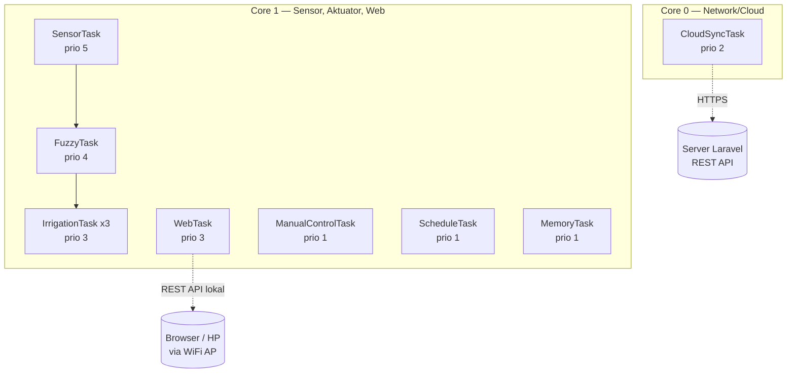
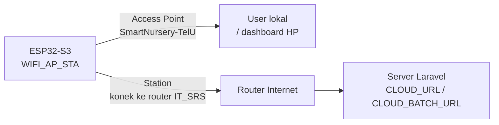
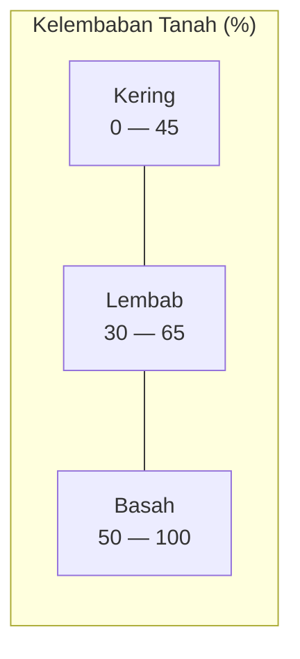

# Ringkasan Project: Smart Nursery Firmware (ESP32-S3)

> Dokumen ini merangkum arsitektur sistem, skema kerja firmware, dan logika fuzzy Mamdani yang digunakan pada project Tugas Akhir **Smart Nursery** — sistem irigasi otomatis berbasis ESP32-S3 dengan kendali fuzzy, mode manual, mode penjadwalan, dashboard web lokal, dan sinkronisasi ke cloud (Laravel REST API).

---

## 1. Ringkasan Singkat

Smart Nursery adalah sistem irigasi otomatis untuk area persemaian (nursery) tanaman yang:

- Membaca kondisi lingkungan secara real-time: **kelembaban tanah**, **suhu udara**, **kelembaban udara**, dan **intensitas cahaya**.
- Menentukan **durasi penyiraman otomatis** menggunakan **Fuzzy Logic Mamdani** berdasarkan kelembaban tanah, suhu, dan cahaya.
- Mendukung 3 mode operasi: **Auto (Fuzzy)**, **Manual**, dan **Schedule (terjadwal via RTC)**.
- Menyediakan **dashboard web lokal** (via WiFi Access Point) untuk monitoring dan kontrol langsung dari browser/HP apabila tidak ada koneksi internet yang bisa akses ke website yg sudah di hosting.
- Mengirim **telemetry ke server cloud** (REST API Laravel) secara periodik, dengan mekanisme **buffer offline** jika koneksi internet putus.
- Menyimpan log historis dan konfigurasi jadwal secara persisten di **LittleFS** (flash internal).

**Platform:** ESP32-S3 (n16r8), Flash 16MB, PSRAM 8MB (OPI), framework Arduino, dibangun dengan PlatformIO. Firmware berjalan di atas **FreeRTOS** dengan 8 task paralel yang terbagi di 2 core.

---

## 2. Arsitektur Hardware

### 2.1 Spesifikasi Board

| Komponen | Spesifikasi |
|---|---|
| MCU | ESP32-S3 (dual-core, 240 MHz) |
| Flash | 16 MB (QIO) |
| PSRAM | 8 MB OPI (Octal SPI) |
| Filesystem | LittleFS |
| Konektivitas | WiFi (mode AP + STA bersamaan) |

### 2.2 Peta Pin (`include/config.h`)

| Fungsi | Pin / Keterangan |
|---|---|
| Soil Moisture (ADC1) — Zona 1–3 | GPIO 1, 2, 3 |
| DHT22 (Suhu & Kelembaban Udara) | GPIO 4 |
| Sensor Cahaya BH1750 | I2C (default SDA/SCL Wire) |
| RTC DS3231 | I2C (berbagi bus dengan BH1750) |
| Relay Utama (Main) | GPIO 13 |
| Relay Zona 1–3 | GPIO 15, 18, 14 |
| Level Aktif Relay | Active LOW (`RELAY_ON = LOW`) |

> Catatan: jumlah zona aktual di firmware adalah **`NUM_ZONES = 3`** (`config.h`). Perlu dicek kembali kesesuaiannya dengan dashboard web, karena pada `data/index.html` tertulis variabel `NUM_ZONES = 5` di sisi JavaScript — ini adalah selisih yang sebaiknya diselaraskan di iterasi berikutnya.

### 2.3 Sensor & Fungsi

| Sensor | Library | Data yang Dihasilkan |
|---|---|---|
| Soil moisture (ADC) x3 | `analogRead()` + regresi linier manual | % kelembaban tanah per zona |
| DHT22 | `DHT sensor library` | Suhu (°C), Kelembaban udara (%) |
| BH1750 | `BH1750` | Intensitas cahaya (Lux) |
| RTC DS3231 | `RTClib` | Waktu real-time (untuk schedule & timestamp log) |

Konversi ADC soil moisture menggunakan regresi linier (lihat `sensor_task.cpp`):

```
Y = 41.7453982 + (-0.012665492 * adc)
soil(%) = clamp( (Y - 10) * (100/25), 0, 100 )
```
>catatan : Task yang saya kasih hanya referensi, bukan menjadi patokan. buat lebih clean code supaya gampang di pahami stuktur dan logic code nya
---

## 3. Skema Sistem

### 3.1 Alur Data Utama (Sensor → Fuzzy → Aktuator)

```mermaid
flowchart LR
    A[Soil/DHT22/BH1750\nSensorTask] -->|update shared state\nzona[i].soil, temperature, humidity, lightLevel| B[(Shared State\nzonaMutex)]
    A -->|xTaskNotifyGive\njika systemMode==Auto| C[FuzzyTask]
    C -->|prosesFuzzyMamdani\nkelembaban, suhu, cahaya| D[Durasi Penyiraman]
    D -->|zona[i].duration, mode=Queued| B
    D -->|xTaskNotifyGive| E[IrrigationTask per Zona]
    E -->|digitalWrite RELAY_PIN| F[(Relay / Pompa)]
    E -->|addLogEntry| G[(LittleFS Log)]
```

### 3.2 Pembagian Task FreeRTOS per Core
>catatan : Ini hanya skema awal, bisa di rewrite lagi menjadi lebih baik. dan buatkan task untuk monitoring memory usage *hanya di serial monitor, tidak masuk ke web* agar saya bisa melihat apakah karena faktor memory, web nya sangan late respon



### 3.3 Dua Jalur Konektivitas WiFi



Firmware menjalankan **AP + STA secara bersamaan** (`WiFi.mode(WIFI_AP_STA)`): AP untuk dashboard lokal yang selalu tersedia, STA untuk konek ke internet demi sinkronisasi cloud. Jika STA putus, data tetap tersimpan lewat buffer offline dan di-flush begitu konek kembali.

---
>catatan : sekali lagi ini hanya referensi saja,  Perhatikan Memori yang akan di gunakan. 
## 4. Daftar Task FreeRTOS

| Task | Core | Priority | Stack | Fungsi | Sinkronisasi |
|---|---|---|---|---|---|
| `SensorTask` | 1 | 5 | 4096 | Baca semua sensor, trigger evaluasi fuzzy | `zonaMutex` |
| `FuzzyTask` | 1 | 4 | 4096 | Evaluasi fuzzy Mamdani per zona, cek cooldown | `zonaMutex`, task notify |
| `IrrigationTask` (x3, satu per zona) | 1 | 3 | 3072 | Eksekusi penyiraman (ON relay → delay durasi → OFF → delay serap air) | `zonaMutex`, `maxConcurrentIrrigationSemaphore`, `mux` (critical section) |
| `WebTask` | 1 | 3 | 8192 | HTTP server lokal (dashboard + REST API) | — (WebServer handler) |
| `CloudSyncTask` | 0 | 2 | 14336 | Kirim telemetry ke cloud setiap 5s, terima `device_command`, kelola buffer offline | `zonaMutex`, `logMutex` |
| `ManualControlTask` | 1 | 1 | 3072 | Matikan relay otomatis saat mode Manual+Timer habis | — |
| `ScheduleTask` | 1 | 1 | 4096 | Cek jadwal RTC setiap menit, trigger irigasi jika waktunya & tanah masih kering | `zonaMutex` |
| `MemoryTask` | 1 | 1 | 2048 | Pantau & cetak status memori (heap/stack) secara periodik | — |

Mekanisme sinkronisasi antar-task:

- **`zonaMutex`** — melindungi struct `zona[]` (state tiap zona) dari race condition.
- **`logMutex`** — melindungi buffer log & file log/offline queue di LittleFS.
- **`maxConcurrentIrrigationSemaphore`** — membatasi jumlah zona yang boleh menyiram bersamaan (maksimal `NUM_ZONES`).
- **`mux` (portMUX_TYPE)** — critical section untuk counter `activeIrrigations`.
- **Task notification (`xTaskNotifyGive` / `ulTaskNotifyTake`)** — digunakan sebagai sinyal ringan (bukan queue) antar `SensorTask → FuzzyTask → IrrigationTask`, lebih hemat RAM dibanding queue/event group.

---

## 5. Mode Operasi Sistem

Sistem memiliki satu variabel global `systemMode`:

| Mode | Nilai | Perilaku |
|---|---|---|
| **Auto (Fuzzy)** | 0 | `SensorTask` memicu `FuzzyTask` setiap siklus baca sensor; durasi siram ditentukan oleh fuzzy logic |
| **Manual** | 1 | User menyalakan/mematikan relay langsung dari dashboard; bisa mode *Toggle* (on/off manual) atau *Timer* (otomatis mati setelah durasi tertentu) |
| **Schedule** | 2 | `ScheduleTask` memicu irigasi sesuai jam:menit yang dikonfigurasi per zona (maks 3 slot/zona), hanya jika kelembaban tanah ≤ 60% |

Perpindahan mode dilakukan via endpoint `POST /api/override` (dari dashboard) atau `device_command.system_mode` dari cloud. Saat berpindah mode, semua relay dipaksa OFF dan state zona direset ke idle untuk mencegah kondisi menggantung (dangling state).

---

## 6. Alur Data End-to-End

1. `SensorTask` membaca soil/DHT22/BH1750 setiap `cfgSensorInterval` detik (default 10s).
2. Jika mode Auto dan tidak ada zona yang sedang aktif menyiram → `FuzzyTask` dibangunkan.
3. `FuzzyTask` menghitung durasi siram per zona via `prosesFuzzyMamdani()`, lalu cek **cooldown** (`cfgCooldown`, default 4 jam) — jika zona baru saja disiram, durasi dipaksa 0.
4. Jika durasi > 0 → `zona[i].mode = Queued`, task `IrrigationTask[i]` dibangunkan.
5. `IrrigationTask` menunggu slot semaphore (maks 3 zona bersamaan), menyalakan relay zona + relay utama, menunggu sesuai durasi, mematikan relay, lalu menunggu 15 detik "jeda serap air" sebelum mencatat log dan reset ke idle.
6. Setiap siklus sensor juga mengecek interval log (`cfgLogInterval`, default 1 jam) — jika waktunya, `addLogEntry()` dipanggil untuk menyimpan snapshot kondisi ke LittleFS.
7. Secara paralel, `CloudSyncTask` (setiap 5 detik) mengirim data telemetry terbaru ke server Laravel. Jika WiFi STA putus, data disimpan ke `offline_q.json` dan dikirim batch begitu koneksi kembali (`flushOfflineBuffer()`).
8. Dashboard web (`WebTask`) melayani permintaan `GET /api/data` setiap 3 detik dari browser untuk menampilkan kondisi terkini secara live.

---

## 7. Logika Fuzzy Mamdani (Inti Sistem Kontrol)

### 7.1 Metode

Sistem menggunakan **Fuzzy Inference System tipe Mamdani** dengan:

- **3 variabel input**: Kelembaban Tanah (%), Suhu Udara (°C), Intensitas Cahaya (Lux)
- **1 variabel output**: Durasi Penyiraman (detik)
- **Operator fuzzy**: `AND` → **MIN**, `OR`/agregasi rule → **MAX**
- **Defuzzifikasi**: **Metode Centroid** (titik berat), dihitung numerik dengan iterasi diskrit `z = 0..222` (step 1 detik)

### 7.2 Variabel Input 1 — Kelembaban Tanah (%)

| Himpunan | Bentuk | Fungsi Keanggotaan |
|---|---|---|
| **Kering** | Turun (shoulder kiri) | `1.0` jika `y ≤ 30`; turun linier sampai `0` di `y = 45` |
| **Lembab** | Segitiga/trapesium | naik `30→45` (0→1), datar `1.0` di `45–50`, turun `50→65` (1→0) |
| **Basah** | Naik (shoulder kanan) | `0` jika `y ≤ 50`; naik linier dari `50→65`; `1.0` jika `y ≥ 65` |



### 7.3 Variabel Input 2 — Suhu Udara (°C)

| Himpunan | Fungsi Keanggotaan |
|---|---|
| **Dingin** | `1.0` jika `x ≤ 22`; turun linier `22→26` |
| **Normal** | naik `24→28` (0→1), turun `28→32` (1→0) |
| **Panas** | naik `30→35` (0→1); `1.0` jika `x ≥ 35` |

### 7.4 Variabel Input 3 — Intensitas Cahaya (Lux)

| Himpunan | Fungsi Keanggotaan |
|---|---|
| **Redup** | `1.0` jika `x ≤ 5000`; turun linier `5000→25000` |
| **Sedang** | naik `5000→35000` (0→1), turun `35000→65000` (1→0) |
| **Terang** | naik `45000→65000` (0→1); `1.0` jika `x ≥ 65000` |

### 7.5 Variabel Output — Durasi Penyiraman (detik)

| Himpunan | Fungsi Keanggotaan | Rentang Efektif |
|---|---|---|
| **Mati** | `1.0` jika `z ≤ 0`; turun `0→10` | 0–10 detik |
| **Pendek** | naik `10→50`, turun `50→90` | 10–90 detik |
| **Sedang** | naik `70→130`, turun `130→190` | 70–190 detik |
| **Lama** | naik `170→222`; `1.0` jika `z ≥ 222` | 170–222+ detik |

### 7.6 Rule Base (Basis Aturan)

Total **24 rule** (kombinasi 3×3×3 = 27 kemungkinan, 3 kombinasi tidak dipetakan/implicit 0), dikelompokkan berdasarkan output:

**→ Output SEDANG** (7 rule)
| Kelembaban | Suhu | Cahaya |
|---|---|---|
| Kering | Dingin | Redup |
| Kering | Dingin | Sedang |
| Kering | Normal | Redup |
| Lembab | Normal | Terang |
| Lembab | Panas | Redup |
| Lembab | Panas | Sedang |
| Lembab | Panas | Terang |

**→ Output LAMA** (6 rule)
| Kelembaban | Suhu | Cahaya |
|---|---|---|
| Kering | Dingin | Terang |
| Kering | Normal | Sedang |
| Kering | Normal | Terang |
| Kering | Panas | Redup |
| Kering | Panas | Sedang |
| Kering | Panas | Terang |

**→ Output PENDEK** (5 rule)
| Kelembaban | Suhu | Cahaya |
|---|---|---|
| Lembab | Dingin | Redup |
| Lembab | Dingin | Sedang |
| Lembab | Dingin | Terang |
| Lembab | Normal | Redup |
| Lembab | Normal | Sedang |

**→ Output MATI** (9 rule — berlaku untuk semua kombinasi Suhu×Cahaya ketika tanah Basah)
| Kelembaban | Suhu | Cahaya |
|---|---|---|
| Basah | Dingin / Normal / Panas | Redup / Sedang / Terang (semua kombinasi) |

**Logika di balik rule base:**
- Tanah **Basah** → selalu **Mati**, apa pun suhu/cahaya (keamanan dari overwatering).
- Tanah **Kering** → cenderung **Lama**, terutama saat suhu Panas/Normal dan cahaya Terang/Sedang (evaporasi tinggi).
- Tanah **Lembab** → cenderung **Pendek** saat Dingin/Normal+Redup/Sedang, dan **Sedang** saat Panas atau cahaya Terang.

### 7.7 Proses Evaluasi (`prosesFuzzyMamdani`)

1. **Fuzzifikasi**: hitung derajat keanggotaan (μ) tiap input pada semua himpunannya (misal `μ_Kering`, `μ_Dingin`, `μ_Redup`, dst).
2. **Evaluasi Rule (Inferensi)**: untuk setiap rule, derajat keanggotaan hasil (α) = `MIN(μ_input1, μ_input2, μ_input3)`. Jika beberapa rule menghasilkan output yang sama (misal beberapa rule → Sedang), nilai α digabung dengan `MAX` (`fungsiMax`) → menghasilkan `r_Mati`, `r_Pendek`, `r_Sedang`, `r_Lama`.
3. **Agregasi & Defuzzifikasi Centroid**: iterasi `z` dari 0 sampai 222 (step 1 detik), untuk setiap `z` hitung:
   ```
   m = MIN(f_Mati(z), r_Mati)
   p = MIN(f_Pendek(z), r_Pendek)
   s = MIN(f_SedangOut(z), r_Sedang)
   l = MIN(f_Lama(z), r_Lama)
   total(z) = MAX(m, p, s, l)
   ```
   Lalu:
   ```
   durasi = Σ(z × total(z)) / Σ(total(z))
   ```
   (titik berat/centroid dari kurva hasil agregasi).
4. **Safety guard**: jika `Σtotal(z) == 0` (tidak ada rule yang aktif) → durasi = 0. Jika hasil centroid `< 10` detik → dibulatkan ke `0` (anggap tidak signifikan untuk menyiram).

**Contoh ilustratif:** kelembaban tanah 25% (Kering penuh, μ=1.0), suhu 33°C (Panas, μ≈0.6; Normal, μ≈0.4... tergantung posisi tepat), cahaya 50000 lux (Terang, μ≈0.25; Sedang, μ≈0.5) → beberapa rule "Kering+Panas+Terang→Lama" dan "Kering+Normal+Sedang→Lama" aktif dengan α masing-masing, menghasilkan `r_Lama` dominan → hasil centroid akan condong ke rentang 190–222 detik (penyiraman lama).

### 7.8 Cooldown Pelindung

Di luar fuzzy logic itu sendiri, `FuzzyTask` menerapkan **cooldown** (`cfgCooldown`, default 4 jam) — jika suatu zona baru selesai disiram dalam rentang waktu tersebut, durasi hasil fuzzy dipaksa menjadi 0 walau secara fuzzy seharusnya menyiram. Ini mencegah penyiraman berulang terlalu sering akibat delay respons sensor terhadap tanah yang baru disiram.

---

## 8. Penyimpanan Data (LittleFS)

| File | Isi | Dikelola oleh |
|---|---|---|
| `/logs.txt` | Log historis (CSV): timestamp, suhu, cahaya, soil before/after per zona, mode, durasi, sysMode — maksimal `MAX_LOG_ENTRIES` (100) entri, circular buffer | `storage_manager.cpp` (`saveLogFile`/`loadLogFile`) |
| `/schedule.json` | Konfigurasi jadwal per zona (hingga `MAX_SCHEDULES` = 3 slot/zona) | `saveSchedule`/`loadSchedule` |
| `/offline_q.json` | Antrian telemetry yang gagal terkirim ke cloud (maks `MAX_OFFLINE_ENTRIES` = 50), di-flush & dihapus setelah sukses batch sync | `saveToOfflineBuffer`/`flushOfflineBuffer` |

`logBuffer` (array `LogEntry` di RAM, cache dari `/logs.txt`) dialokasikan secara dinamis saat boot agar tidak membebani BSS statis.

---

## 9. Antarmuka Web (Dashboard Lokal)
>catatan : saat ini semua fitur di web sangat late respon, dan saat menghubungkan ke RTC tidak bisa bisa. *gunakan style seperti di referensi*

Dashboard (`data/index.html` + `data/style.css`) diakses lewat WiFi Access Point (`SmartNursery-TelU`) tanpa perlu internet. Fitur utama: kartu sensor real-time, kontrol valve/relay per zona, pemilihan mode sistem, konfigurasi interval & jadwal, export log ke CSV, sinkronisasi waktu RTC dari browser.

| Endpoint | Method | Fungsi |
|---|---|---|
| `/` , `/style.css` | GET | Serve halaman dashboard (dari LittleFS) |
| `/api/data` | GET | Snapshot kondisi sistem (sensor, mode, status relay) |
| `/api/override` | POST | Ganti `systemMode` (Auto/Manual/Schedule) |
| `/api/relay` | POST | Toggle relay saat mode Manual |
| `/api/config` | GET/POST | Baca/ubah konfigurasi (interval sensor, mode manual, durasi, interval log, cooldown) |
| `/api/schedule` | GET/POST | Baca/ubah jadwal penyiraman per zona |
| `/api/log` | GET | Ambil seluruh log historis (untuk export CSV) |
| `/api/log/reset` | POST | Hapus semua log |
| `/api/sync-time` | POST | Set waktu RTC dari jam browser |

Polling dashboard: `fetchData()` setiap 3 detik untuk data live.

---

## 10. Integrasi Cloud (Laravel REST API)

- **Endpoint utama:** `CLOUD_URL` (telemetry tunggal), `CLOUD_BATCH_URL` (batch, untuk flush buffer offline).
- **Autentikasi sederhana:** header `X-Device-Token` berisi `DEVICE_KEY` (identitas device).
- **Siklus `CloudSyncTask`** (setiap 5 detik):
  1. Jika ada buffer offline → flush dulu.
  2. Kirim payload telemetry terbaru (suhu, humidity, cahaya, mode sistem, kondisi tiap zona) via `HTTPClient POST`.
  3. Jika sukses, server bisa membalas `device_command` (perintah dari dashboard cloud): ubah `system_mode`, `manual_mode_type`, `manual_duration`, atau `schedules` — firmware langsung menerapkan perubahan ini ke state lokal.
  4. Jika gagal (HTTP error) → payload disimpan ke `offline_q.json` untuk dicoba lagi nanti.
- Jika WiFi STA terputus total → tetap menyimpan snapshot ke buffer offline setiap 30 detik, dan mencoba `WiFi.reconnect()` setiap 20 detik (tanpa mengganggu AP yang sedang melayani dashboard lokal).

---

## 11. Catatan Penutup

Beberapa hal yang bisa menjadi catatan pengembangan lanjutan (bukan bagian dari implementasi saat ini, hanya observasi):

- Sinkronisasi jumlah zona (`NUM_ZONES`) antara firmware (`config.h` = 3) dan dashboard web (`index.html` mendefinisikan 5) sebaiknya diselaraskan.
- Parameter himpunan fuzzy (breakpoint angka pada bagian 7.2–7.5) saat ini masih hardcoded di `fuzzy_logic.cpp`; dashboard sudah menyediakan field konfigurasi fuzzy di UI namun endpoint `/api/fuzzy-config` belum ditemukan implementasinya di `web_task.cpp` pada saat dokumen ini dibuat.
- Rule base fuzzy sudah cukup lengkap untuk 3×3×3 kombinasi; nilai breakpoint sebaiknya dikalibrasi lebih lanjut dengan data lapangan aktual sesuai jenis tanaman nursery yang menjadi objek penelitian TA.

---

*Dokumen ini dibuat sebagai rangkuman arsitektur & logika sistem project Smart Nursery (repo: `C:\FIRMWARE_TA`), untuk keperluan referensi/lampiran di luar repository kode.*
